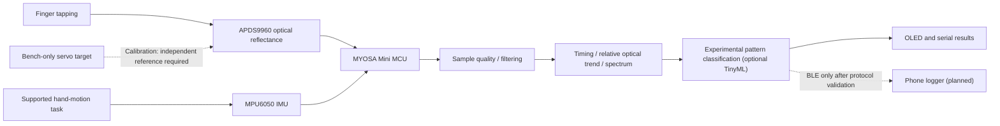

# Proposed TremoTap architecture (not yet built)

The APDS9960 signal is intensity, not calibrated millimeters. The servo does not imply proven 4–6 Hz mechanical motion. Report descriptive features and experimental patterns only—never a Parkinson's diagnosis.
